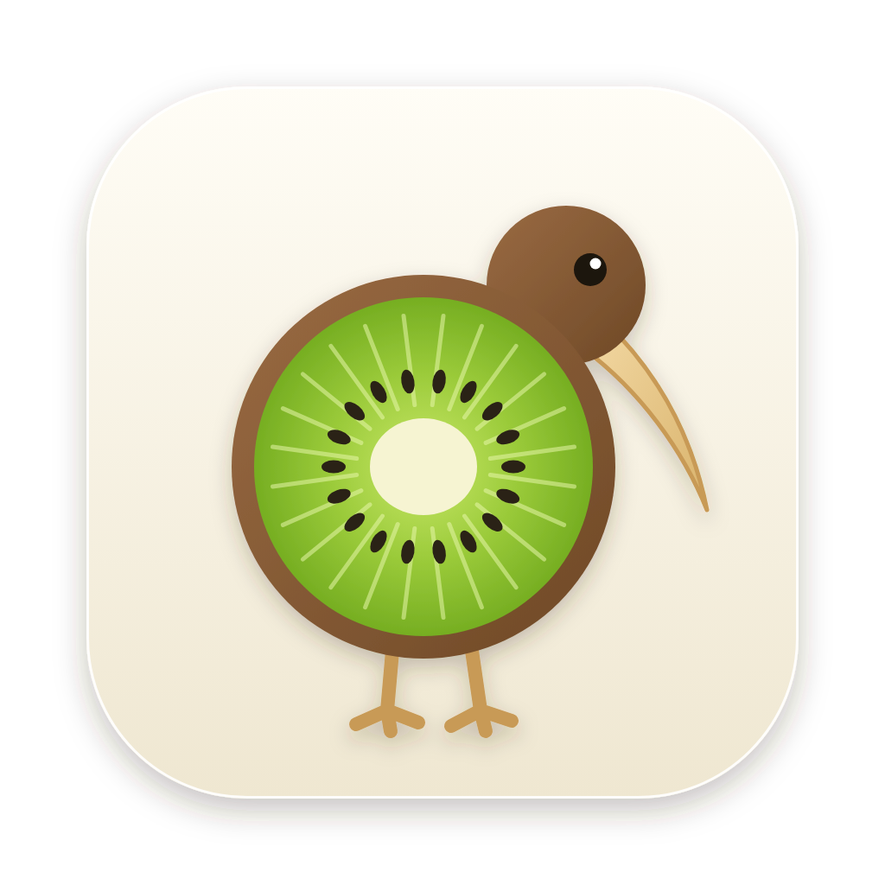

<p align="center">
  
</p>

<h1 align="center">Kiwi</h1>

<p align="center">
  A featherweight menu bar companion for macOS: screenshots that redact themselves, scrolling capture, screen recording, and a radial wheel for the files you drag.
</p>

---

Kiwi lives in the menu bar.

**Capture.** Press ⇧⌘4, drag, and the image is on your clipboard with the editor open, ready to mark up. Prefer to stay out of the way? Switch to a glass preview in the corner with Copy, Edit, Save and Delete.

**Redact.** One click finds emails, phone numbers, card numbers, IDs, keys and tokens, and addresses, and covers them with solid boxes. Kiwi can do it automatically before a capture ever reaches the clipboard.

**Scroll and record.** ⇧⌘6 stitches a page while you scroll. ⇧⌘5 records an area to MP4.

**The wheel.** Start dragging files in Finder, tap ⇧, ⌘ or ⌃, and a glass wheel opens under the pointer. Drop on a slice to convert, resize, compress, strip metadata, redact, hash or share.

Everything runs on your Mac. Kiwi makes no network connections. See [SECURITY.md](SECURITY.md).

## Requirements

- macOS 26 (Tahoe) or later
- Swift 6.2 or later to build. The Command Line Tools are enough; Xcode is not required.

## Build and run

```sh
make run        # build, sign with the hardened runtime, report, and launch
make verify     # build and fail on any security finding
make install    # copy Kiwi.app to /Applications and launch it
```

Other targets: `make build`, `make app`, `make checksum`, `make uninstall`, `make reset-permissions`, `make clean`.

## First launch

Kiwi opens a short setup guide:

1. **Screen Recording.** macOS requires this permission for any screenshot tool. Allow Kiwi in System Settings → Privacy & Security → Screen & System Audio Recording, then relaunch Kiwi.
2. **The native shortcuts.** macOS keeps ⇧⌘3, ⇧⌘4 and ⇧⌘5 for itself until you release them. Open System Settings → Keyboard → Keyboard Shortcuts → Screenshots and untick those rows.

## Shortcuts

| Shortcut | Action |
| --- | --- |
| ⇧⌘4 | Capture an area. Space switches to window capture. Esc or right-click cancels. |
| ⇧⌘3 | Capture the screen under the pointer |
| ⇧⌘5 | Record an area or window. Press again, or click the menu bar timer, to stop. |
| ⇧⌘6 | Scrolling capture. Pick the area, scroll, then press Done or ⇧⌘6 again. |
| ⇧⌘2 | Open the last capture in the editor |

These are the defaults. Change any of them in Settings → Shortcuts: click the shortcut and press the new keys.

**Capture After Delay** in the menu lets you pick the area first and captures it 3, 5 or 10 seconds later, which leaves time to open a menu or hover over something.

## After a capture

- The image is copied to the clipboard immediately (configurable).
- The editor opens straight away. Turn off *Open the editor right after a capture* in Settings to get a corner preview instead; it stays for a few seconds and pauses while the pointer is over it.
- **Copy**, **Edit**, **Save**, **Delete** act on the capture. Delete removes the working copy, moves any saved copy to the Trash, and clears the clipboard if it still holds that image.
- Drag the thumbnail into Slack, Mail, Finder, or anywhere that accepts a PNG.
- Saved captures and recordings go to `~/Pictures/Kiwi` unless you choose another folder.
- The menu bar menu lists the session's **Recent Captures**; pick one to open it in the editor again. The list is cleared when Kiwi quits.

## Redaction

- **In the editor:** press the Redact button (⌘R). Kiwi reads the text on-device and adds a solid box over each match. Boxes are ordinary annotations until you export: move them, delete the ones you do not want, or add your own with the Redact tool (X).
- **Automatically:** turn on *Redact every capture* in Settings. The scan runs before anything is copied or saved. If it fails, nothing is copied.
- **On files:** drop images on the wheel's Redact slice for a redacted copy.

After a scan, Kiwi says what it covered ("2 emails, 1 ID number") and outlines the new boxes for a few seconds so you can check them.

What it looks for: email addresses, phone numbers, payment cards (Luhn-checked), CPF, RG, CNPJ, CNH, PIS, voter ID, passport and SSN, AWS/GitHub/GitLab/Slack/Stripe/Google/OpenAI-style keys, JWTs, bearer tokens, private key headers, `password=` style assignments, long hex and random strings, IPv4/IPv6 and MAC addresses, and optionally faces. Each category can be switched off.

Detection is best effort. Look at the result before you share it.

## Scrolling capture

Pick the region that scrolls, then scroll down at a steady pace. Kiwi matches each frame against the last one and appends only the new rows, so pausing or scrolling back up does no harm. Sticky headers and footers are kept once. If Kiwi loses track (you scrolled too fast), it says so: scroll back up a little and continue. Pages that move on their own, such as a playing video or an animation, are fine as long as the moving part is under about half of the area. The result goes through the normal preview, including auto-redaction.

## Recording

Recordings are MP4 (MOV when the microphone is on) at up to 60 fps, scaled to 4K at most, written directly by ScreenCaptureKit. The codec is HEVC by default, with H.264 available in Settings for wider compatibility. System audio and the microphone are both optional and off by default. The first time you turn the microphone on, macOS asks for permission. The red outline and Kiwi's own windows never appear in the video.

**GIF.** The preview that appears after a recording has a GIF button, and the menu has *Make GIF of Last Recording*. The GIF is written next to the video and loops. To keep the file reasonable it is at most 640 px on its longest side and 180 frames: 12 frames a second for clips up to 15 seconds, fewer for longer ones.

## Editor

| Key | Tool | Key | Tool |
| --- | --- | --- | --- |
| V | Select and move | T | Text |
| A | Arrow | N | Step number |
| L | Line | B | Pixelate |
| R | Rectangle | X | Redact (solid) |
| O | Ellipse | C | Crop |
| P | Pen | H | Highlighter |

Hold ⇧ while drawing to snap lines to 45° and shapes to squares and circles. With the Select tool, drag a shape to move it, drag one of its handles to resize it, or drag empty space to move the image when zoomed in. Holding Space turns any tool into a hand for the same purpose.

| Shortcut | Action |
| --- | --- |
| Return | Copy the result and close |
| ⌘R | Auto-redact |
| ⇧⌘C | Copy all the text in the image. The toolbar's text button lets you drag over just the part you want. |
| ⌘C / ⌘S / ⇧⌘S | Copy / Save / Save As |
| Convert menu | Save the edited image as PNG, JPEG, HEIC, AVIF, TIFF or PDF |
| ⌘Z / ⇧⌘Z | Undo / Redo |
| ⌘+ / ⌘− / ⌘0 / ⌘1 | Zoom in / out / fit / actual size. Pinch or ⌘-scroll also zooms; scroll pans. |
| ⌫ | Delete the selected annotation |
| ⌘⌫ | Delete the screenshot |

Type in the name field at the top left of the editor and press Return to rename a capture. The name is used for Save, Convert, Save As and drag-out, and a file that was already saved is renamed on disk.

The pin button keeps the image floating above your other windows. Drag a pin to move it, pinch or scroll to resize it, double-click to close it, right-click for more. Pins never appear in later captures.

Closing the editor window keeps your edits: the edited image replaces the copy on the clipboard. To throw the capture away, use Delete. A file is written to your screenshots folder only when you press Save, export, or have *Also save every capture* on.

## The wheel

While dragging one or more files:

| Tap | Ring | Slices |
| --- | --- | --- |
| ⇧ | Convert | PNG, JPEG, HEIC, AVIF, TIFF, PDF |
| ⌘ | Tools | Half size, Fit 1920, Compress, Strip info, Redact, Edit |
| ⌃ | Actions | Copy, Copy path, Reveal, SHA-256, Copy text, Share |

Drop on a slice to run it. Drop on the hub, or anywhere outside the wheel, to cancel. Keys that were already held when the drag began are ignored.

Results are written next to the originals with Finder-style names (`photo 2.jpg`). Originals are never modified or deleted, and one file failing does not stop the rest. Conversion quality is adjustable in Settings.

## Design notes

- **Light by default.** An AppKit agent with no Dock icon, no background polling and no dependencies. Timers run only during a file drag, a scrolling capture or a recording.
- **Minimal permissions.** Screen Recording is the only permission Kiwi asks for.
- **Native glass.** Floating UI uses the system Liquid Glass material, hosted in non-activating panels so the app you are working in keeps focus. Motion respects Reduce Motion.
- **Secure by construction.** Hardened runtime, a single entitlement (the optional microphone), no network code, strict memory safety checks, and a verify script that proves it on every build.

## Project layout

```
Sources/Kiwi/
  App/        entry point, menu bar item, hotkeys, preferences
  Capture/    selection overlay, grabber, scrolling capture, recorder, preview
  Redaction/  sensitive-text patterns and the on-device scanner
  Editor/     annotation model and renderer, canvas, editor window
  Wheel/      drag watcher, wheel model and view, drop handling
  Engine/     image conversion on ImageIO, checksums
  UI/         shared panels, toast, settings, setup guide
Resources/    Info.plist, entitlements, app icon
scripts/      verify.sh
```

## Troubleshooting

**⇧⌘4 still opens the macOS tool.** The native shortcut is still enabled. See *First launch*, step 2.

**macOS asks for Screen Recording again after every rebuild.** With ad hoc signing, each build looks like a new app to macOS. Run `bash scripts/setup-signing.sh` once: it creates a local code signing identity named `Kiwi Local`, which the Makefile then uses automatically. Allow Kiwi one more time after the next build and the grant survives every rebuild after that.

**macOS asks to confirm screen recording from time to time.** That is a system policy for all third-party capture tools.

**Open at login does nothing.** Run `make install` first so Kiwi lives in /Applications.
